::: {.hero}
{.light-content fig-alt="Decorative statistical artwork"}
{.dark-content fig-alt="Decorative statistical artwork"}
:::

::: {.eyebrow}
About me
:::

My name is John **Muschelli** (pronounced Moo-shell-e),
and I am an Associate Research Professor in the Department of Biostatistics at the
[Johns Hopkins Bloomberg School of Public Health](https://publichealth.jhu.edu/) (JHSPH).
I received my ScM in Biostatistics under the advising of Brian Caffo and my PhD
under Ciprian Crainiceanu, both from JHSPH, and a BS in Biomathematics and
Neuroscience from the University of Scranton.

I work on wearable and accelerometry data (step counts, sleep, physical activity
in studies like NHANES and UK Biobank) and on processing and analyzing medical
images, usually of the brain ([more on my research](research.qmd)). I write a lot of [R software](software.qmd) to make
that easier, [teach](teaching.qmd) data science, and co-host the podcast
[The Corresponding Author](projects.qmd#podcast).

My blog, [A HopStat and a Jump Away](https://hopstat.wordpress.com), is updated
much more often than this site.

::: {.callout-card}
**Collaborators** ·
[Ciprian Crainiceanu](https://publichealth.jhu.edu/faculty/2020/ciprian-m-crainiceanu),
[Brian Caffo](http://www.bcaffo.com/),
Dan Hanley, and
Stewart Mostofsky.

**Affiliations** ·
[JHSPH Biostatistics](https://publichealth.jhu.edu/departments/biostatistics) ·
[SMART](http://www.smart-stats.org/) ·
[BIOS](http://braininjuryoutcomes.com/) ·
[LNIR](http://lnir.kennedykrieger.org/)

**Recognition** ·
2025 Excellence in Teaching Award (Johns Hopkins) ·
2014 SOURCE Community Service Award ·
winning team, 2011 ADHD-200 Global Competition ·
Presidential Scholar, University of Scranton
:::

## Bio & headshot {#bio}

For talk announcements and event programs:

> John Muschelli is an Associate Research Professor in the Department of
> Biostatistics at the Johns Hopkins Bloomberg School of Public Health. His
> research focuses on wearable and accelerometry data, including step counts,
> sleep, and physical activity in studies such as NHANES and the UK Biobank,
> and on the analysis of medical images of the brain. He has written more than
> 30 R packages on CRAN, co-hosts the podcast *The Corresponding Author*, and
> received the 2025 Johns Hopkins Excellence in Teaching Award. He holds an ScM
> and PhD in Biostatistics from Johns Hopkins and a BS in Biomathematics and
> Neuroscience from the University of Scranton.

[Download headshot](images/headshot-full.jpg){download="john-muschelli-headshot.jpg"}
(JPG, 1920 × 2880, 0.9 MB) · Photo: Chris Hartlove

## Contact {#contact}

| Department of Biostatistics, Johns Hopkins University
| 615 N. Wolfe Street, Baltimore, MD 21205
| Email: jmuschel [at] jhsph [dot] edu
